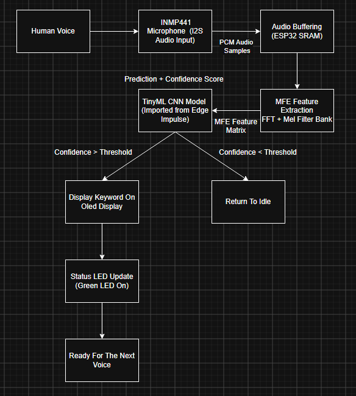
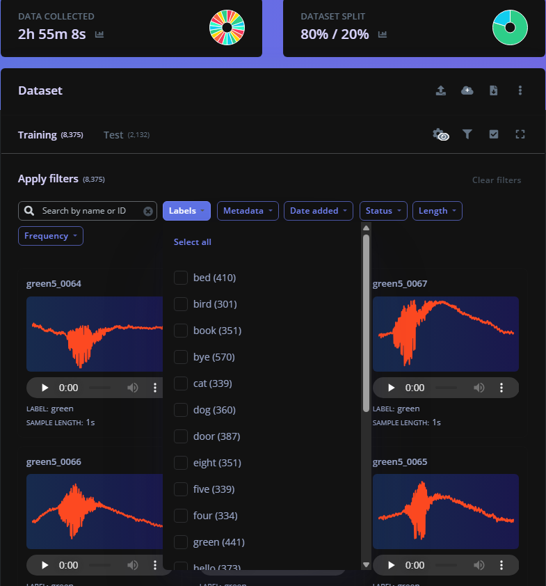
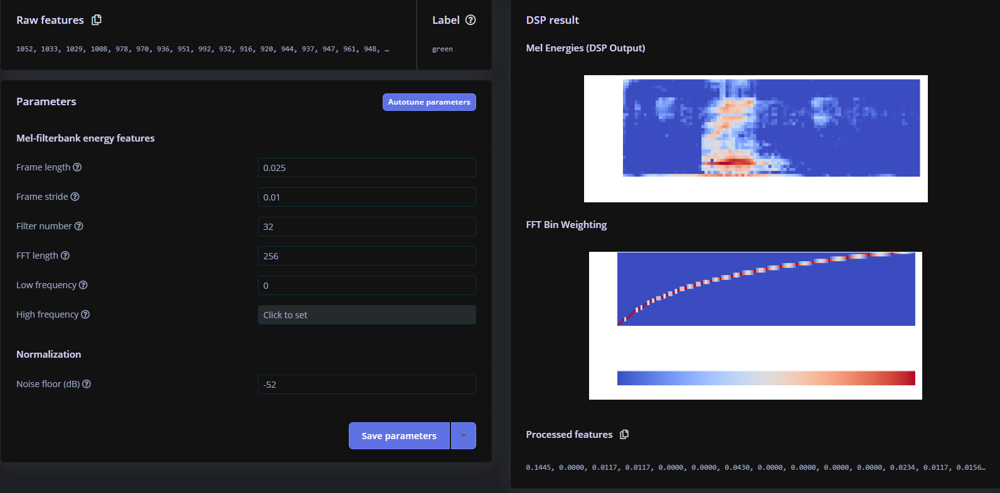
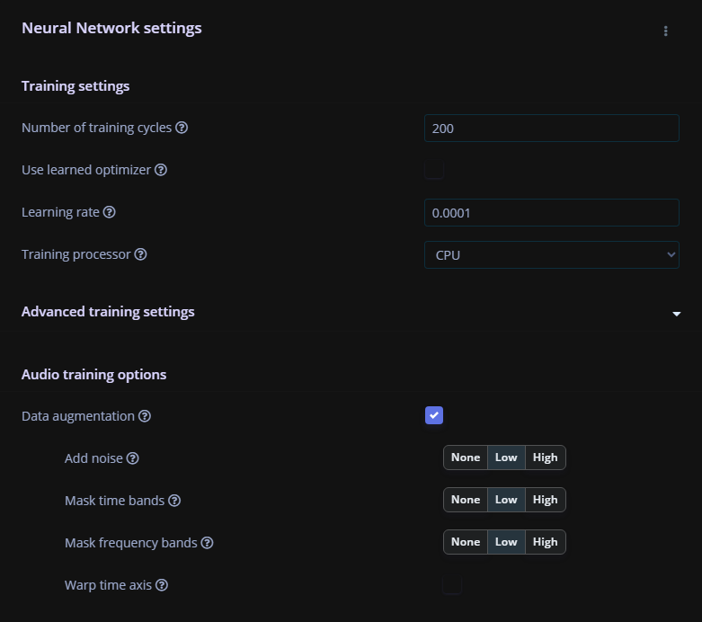
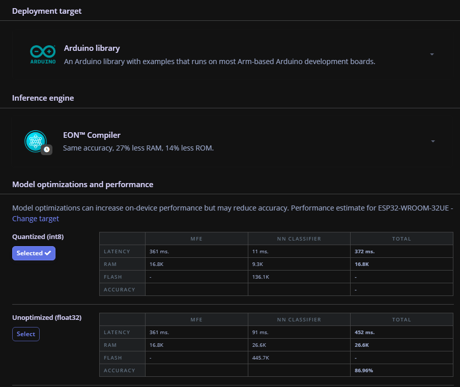
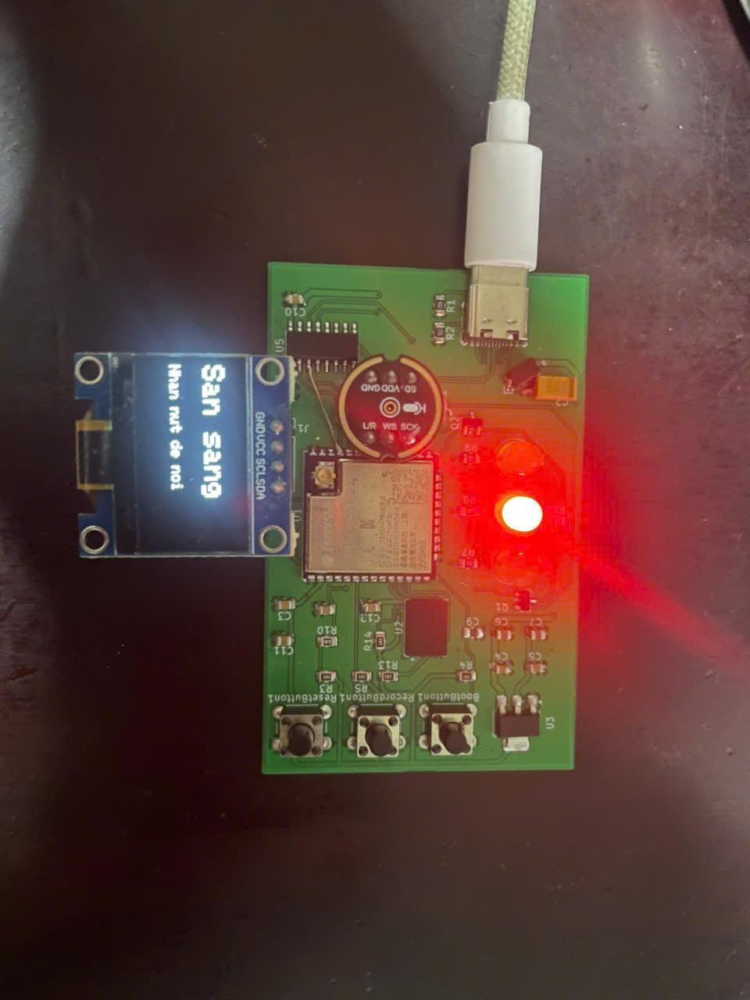
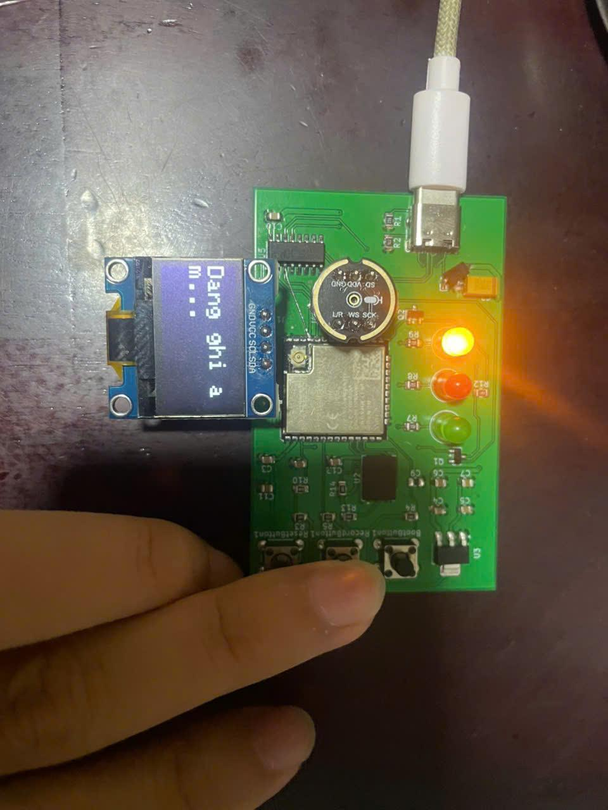
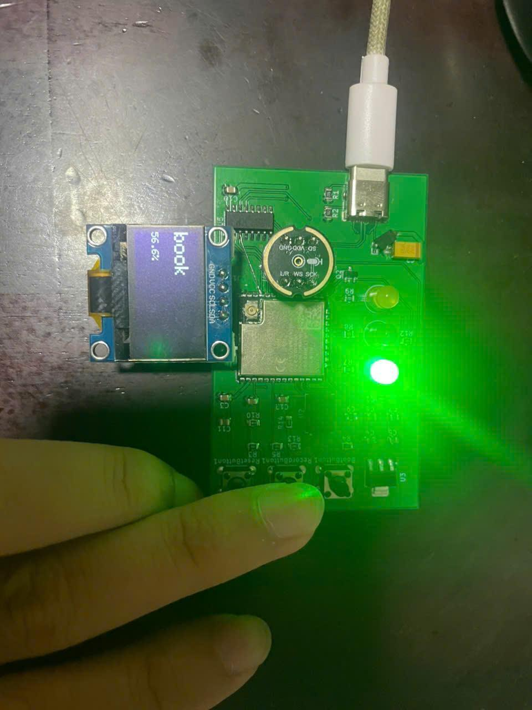

# 🎙️ AI Speech-to-Text — Embedded Keyword Spotting on ESP32 (TinyML)

> An offline, standalone voice-command recognizer built on a **custom-designed ESP32-S3 PCB**, an **INMP441** digital microphone, and a **1D-CNN keyword-spotting model** trained with **Edge Impulse**. No cloud, no internet — everything runs on the microcontroller.

[](#hardware)
[](#machine-learning-pipeline)
[-00979D)](#firmware)
[](LICENSE)

---

## Table of Contents

- [Overview](#overview)
- [Key Features](#key-features)
- [System Architecture](#system-architecture)
- [Hardware](#hardware)
- [How It Works](#how-it-works)
- [Machine Learning Pipeline](#machine-learning-pipeline)
- [Repository Structure](#repository-structure)
- [Getting Started](#getting-started)
- [Usage](#usage)
- [Results](#results)
- [Roadmap](#roadmap)
- [Team](#team)
- [License](#license)
- [Citation](#citation)

---

## Overview

Manual transcription of meetings, lectures, and voice notes is slow and error-prone, and most recording tools only capture raw audio without any structure. This project explores a lightweight alternative: a **fully offline embedded keyword-spotting (KWS) device** that listens for short spoken commands and displays the recognized word directly on a screen, in real time, with no network connection required.

The system was built end-to-end — from a **custom-fabricated PCB** around the ESP32-WROOM-32UE, to a **self-collected voice dataset**, to a **TinyML CNN model** trained on Edge Impulse and deployed back onto the same chip for on-device inference.

This repository was originally developed as the final project for course **CDP301 (Capstone Design Project) at FPT University**. The full academic report is included in [`docs/report/`](docs/report/CDP301_Final_Report.pdf).

## Key Features

- 🔌 **Fully offline** — audio capture, feature extraction, and CNN inference all run locally on the ESP32; no Wi-Fi/cloud dependency at inference time.
- 🎛️ **Custom hardware** — self-designed and self-fabricated PCB (ESP32-WROOM-32UE, INMP441 I2S MEMS mic, SSD1306 OLED, status LEDs, SPI flash, USB-UART).
- 🧠 **TinyML CNN keyword spotting** — 1D-CNN trained on Mel-Filterbank Energy (MFE) features, quantized to INT8 and compiled with Edge Impulse's EON Compiler.
- 📊 **Self-collected + synthetic dataset** — real recordings captured through the custom board over serial, augmented with synthetic TTS samples.
- 💡 **Visual feedback loop** — 3-color status LEDs (red = recording, yellow = processing, green = result ready) and a 0.96" OLED showing the predicted word + confidence score.
- 🛠️ **Reusable data-capture tooling** — a push-to-talk Python script + a dedicated firmware sketch to build your own voice dataset with the same hardware.

## System Architecture

<p align="center">
  
</p>

The ESP32-WROOM-32UE is the central controller. It reads PCM audio from the INMP441 microphone over I2S, runs on-device inference with the TinyML model exported from Edge Impulse, drives the SSD1306 OLED over I2C for output, and manages three status LEDs and three push buttons (Reset / Boot / Record). A CH340N USB-to-UART bridge handles firmware flashing, serial debugging, and dataset streaming from a PC.

**End-to-end data flow:**

<p align="center">
  
</p>

1. **Voice Acquisition** — user speaks into the INMP441; audio streams to the ESP32 over I2S.
2. **Audio Buffering** — 1 second of PCM samples (16 kHz) is buffered in SRAM.
3. **Feature Extraction (MFE)** — framing → FFT → Mel filterbank → Mel-Frequency Energy matrix.
4. **CNN Inference** — the on-device TinyML model scores every class and returns the top prediction + confidence.
5. **Decision Making** — prediction is accepted only if confidence exceeds a threshold; otherwise treated as noise/unknown.
6. **User Feedback** — result + confidence (%) shown on the OLED; the corresponding status LED lights up; buffer clears and the system returns to idle.

## Hardware

### Bill of Materials

| Component | Role | Notes |
|---|---|---|
| **ESP32-WROOM-32UE** | Main controller | 240 MHz dual-core, 520 KB SRAM, external-antenna variant for stable RF inside an enclosure |
| **INMP441** | I2S digital MEMS microphone | 24-bit PCM output, no external ADC needed |
| **SSD1306 0.96" OLED** | Result display | I2C, shows predicted keyword + confidence |
| **AMS1117-3.3** | LDO voltage regulator | 5 V (USB) → stable 3.3 V rail, up to 800 mA |
| **CH340C / CH340N** | USB-to-UART bridge | Firmware flashing, serial debug, dataset streaming |
| **W25Q256JVEIQ** (SPI NOR flash) | Non-volatile storage | Firmware / app data over SPI |
| **3× Status LED** (Red / Yellow / Green) | Visual feedback | Recording / Processing / Result-ready |
| **3× Push button** | User controls | Reset, Boot (flash mode), Record |

### Pinout / Wiring

| Module | Signal | ESP32 GPIO (physical pin) | Notes |
|---|---|---|---|
| INMP441 (I2S Mic) | SD | IO16 (pin 27) | I2S data |
| | WS | IO17 (pin 28) | I2S word select |
| | SCK | IO4 (pin 26) | I2S bit clock |
| | L/R | GND (tied low) | Selects left channel |
| SSD1306 (I2C OLED) | SCL | IO21 (pin 33) | I2C clock |
| | SDA | IO22 (pin 36) | I2C data |
| W25Q Flash (SPI) | CS | IO23 (pin 37) | Chip select |
| | SCK | IO25 (pin 10) | SPI clock |
| | MOSI | IO26 (pin 11) | |
| | MISO | IO27 (pin 12) | |
| Status LEDs | Red | IO5 (pin 29) | via 10 kΩ resistor |
| | Yellow | IO18 (pin 30) | via 10 kΩ resistor |
| | Green | IO19 (pin 31) | via 10 kΩ resistor |
| Buttons | Boot | IO0 (pin 25) | 10 kΩ pull-up + 0.1 µF |
| | Record | IO34 (pin 6) | 10 kΩ pull-up, input-only pin |
| | Reset | EN pin | 10 kΩ pull-up + 0.1 µF |
| CH340C (USB-UART) | TXD → RX | IO1 / TXD0 (pin 35) | To PC via USB-C |
| | RXD ← TX | IO3 / RXD0 (pin 34) | |

> ⚠️ These pin assignments are specific to the custom PCB in this project (see schematic below). If you're prototyping on a generic ESP32 dev board / breadboard, you can remap these in the `#define` block at the top of [`firmware/final/final.ino`](firmware/final/final.ino) — just avoid GPIO6–11 (connected to internal flash) and remember GPIO34–39 are input-only with no internal pull-up/down.

### Schematic

<p align="center">
  
</p>

Full schematic sheet covering the ESP32 core, USB-C input, status LEDs, SPI flash, OLED/microphone headers, buttons with debounce/auto-reset circuitry, the CH340C USB-UART bridge, and the AMS1117 power supply.

### PCB

The board was designed and hand-fabricated in-house. Source design files (KiCad project, Gerbers, BOM/CPL) and high-resolution PCB renders live in [`hardware/`](hardware/) — see [`hardware/README.md`](hardware/README.md) for how to add your own design files if you're forking this project with a different layout.

## How It Works

| Step | Action | LED |
|---|---|---|
| 1. Voice Recording | Press **Record** → ESP32 initializes I2S and buffers 1 s of audio from the INMP441 | 🔴 Red |
| 2. Feature Extraction | Buffered audio is converted to an MFE (Mel-Frequency Energy) spectrogram | 🟡 Yellow |
| 3. TinyML Inference | The MFE matrix is fed into the on-device CNN; highest-probability class + confidence is selected | 🟡 Yellow |
| 4. Display & Feedback | If confidence clears the threshold, the keyword + confidence % is shown on the OLED and the matching LED lights up; otherwise the input is discarded as noise | 🟢 Green |

## Machine Learning Pipeline

### 1. Dataset

Voice samples were recorded directly through the custom hardware: the [`data_capture_device`](firmware/data_capture_device/data_capture_device.ino) firmware streams 1-second, 16 kHz / 16-bit PCM WAV clips from the INMP441 over serial (921 600 baud) on command, and the companion [`capture_audio.py`](tools/capture_audio.py) push-to-talk script on the PC saves each take to disk — hold **Space** to record, release to stop, per label.

| Parameter | Value |
|---|---|
| Sample rate | 16 kHz |
| Bit depth | 16-bit PCM |
| Clip length | 1000 ms (1 s) |
| Samples per class | ~120–200 real recordings + ~100–150 synthetic (OpenAI TTS) |
| Train / Validation split | 80 / 20 (Edge Impulse default) |

<p align="center">
  
</p>

**Deployed model — 22 classes** (as trained and evaluated in the final confusion matrix, one of them being the `noise` / negative class):

`bed · bird · book · bye · cat · dog · door · eight · five · four · green · hello · nine · noise · one · red · seven · six · ten · three · two · yellow`

> Note: earlier iterations of the dataset targeted a broader 23-word set (including `stop` and `zero`); the final model that was trained, quantized, and deployed to the board recognizes the 22 classes above, per the confusion matrix and evaluation results in the [full report](docs/report/CDP301_Final_Report.pdf).

Raw `.wav` recordings are **not committed to this repository** (dataset size / privacy) — see [`dataset/README.md`](dataset/README.md) for how the data was organized and how to regenerate your own set with the same tools.

### 2. Feature Extraction — Mel-Filterbank Energy (MFE)

<p align="center">
  
</p>

| Parameter | Value |
|---|---|
| Frame / window length | 25 ms |
| Frame stride | 10 ms |
| Number of Mel filters | 32 |
| FFT length | 256 |
| Frequency range | 0 – 8000 Hz |
| Noise floor | −52 dB |

MFE was chosen over MFCC: it skips the DCT compression step, preserving more spectral detail for the CNN's convolutional filters to learn from, at lower computational cost — a good fit for a resource-constrained MCU.

### 3. Model Architecture — 1D CNN

<p align="center">
  
</p>

```
Input (3136 features)
  → Reshape (32 columns)
  → Conv1D (16 filters, kernel 3) → Dropout (0.25)
  → Conv1D (32 filters, kernel 3) → Dropout (0.25)
  → Flatten
  → Dense (128 neurons) → Dropout (0.25)
  → Output (22 classes, softmax)
```

| Parameter | Value |
|---|---|
| Framework | TensorFlow / Keras (via Edge Impulse) |
| Epochs | 200 |
| Learning rate | 0.0001 |
| Data augmentation | Add noise, time/frequency masking |

### 4. Training Results

<p align="center">
  
</p>

<p align="center">
  
</p>

**Validation accuracy: 91.2%** (loss 0.36) across 22 classes — see the full per-class precision/recall/F1 breakdown in the report.

### 5. Quantization & Deployment

<p align="center">
  
</p>

| Parameter | Value |
|---|---|
| Quantization | INT8 (EON Compiler) |
| Exported model size | 136.1 KB (Flash) |
| Runtime RAM (tensor arena) | 16.8 KB |
| Estimated total latency | ~372 ms (MFE + inference) on ESP32-WROOM-32UE |
| Deployment target | Arduino library (Edge Impulse export) |

The trained model is exported from Edge Impulse as an **Arduino library** and imported into the firmware as `AI_Speech_to_text_inferencing.h`. See [`ml/README.md`](ml/README.md) for how to regenerate and install this library.

## Repository Structure

```
.
├── firmware/
│   ├── final/                     # Main standalone inference firmware (OLED + LEDs + CNN)
│   │   └── final.ino
│   └── data_capture_device/       # Firmware used only for dataset collection (streams WAV over serial)
│       └── data_capture_device.ino
├── tools/
│   └── capture_audio.py           # PC-side push-to-talk recorder (pairs with data_capture_device)
├── ml/
│   ├── README.md                  # Edge Impulse project setup + model export/import instructions
│   └── edge-impulse-model/        # Drop your exported Edge Impulse Arduino library .zip here
├── dataset/
│   └── README.md                  # Label list, recording protocol, folder layout for raw data
├── hardware/
│   ├── README.md
│   ├── schematic/                 # KiCad schematic source (add your files here)
│   └── pcb/                       # PCB layout / Gerbers / BOM (add your files here)
├── docs/
│   ├── images/                    # Diagrams and photos used in this README
│   └── report/
│       └── CDP301_Final_Report.pdf
├── LICENSE
├── .gitignore
└── README.md
```

## Getting Started

### Requirements

- **Arduino IDE** (2.x recommended) with the **ESP32 board package** (espressif/arduino-esp32) installed, board: `ESP32 Dev Module`
- Arduino libraries: `Adafruit_GFX`, `Adafruit_SSD1306`, and the Edge Impulse–exported inferencing library (see [`ml/README.md`](ml/README.md))
- **Python 3.9+** with `pyserial` and `keyboard` (only needed for dataset capture — see [`tools/`](tools))
- A USB-C cable and the custom PCB (or a breadboard wired per the [pinout table](#pinout--wiring))
- An [Edge Impulse](https://edgeimpulse.com/) account (only needed if you want to retrain the model)

### 1. Build / wire the hardware

Assemble the board per the [schematic](docs/images/04-schematic.jpg) and [pinout table](#pinout--wiring), or use the fabricated PCB in [`hardware/`](hardware/).

### 2. (Optional) Collect your own dataset

```bash
# 1. Flash the data-capture firmware to the ESP32
#    Open firmware/data_capture_device/data_capture_device.ino in Arduino IDE and upload.

# 2. Install Python dependencies
pip install pyserial keyboard

# 3. Edit tools/capture_audio.py — set PORT and LABEL, then run:
python tools/capture_audio.py
# Hold SPACE to record a 1s clip, release to stop, ESC to quit.
```

Repeat per label to build a balanced dataset (see [`dataset/README.md`](dataset/README.md) for the full label list and recommended sample counts).

### 3. Train the model on Edge Impulse

Upload your `.wav` clips to an Edge Impulse project, configure the MFE processing block and the 1D-CNN learning block with the parameters in the [ML pipeline section](#machine-learning-pipeline) above, train, and deploy as an **Arduino library**. Full walkthrough in [`ml/README.md`](ml/README.md).

### 4. Flash the inference firmware

```bash
# 1. Install the exported Edge Impulse library (Sketch > Include Library > Add .ZIP Library...)
# 2. Open firmware/final/final.ino in Arduino IDE
# 3. Select board: ESP32 Dev Module, correct COM port
# 4. Upload
```

## Usage

1. Power the board over USB-C.
2. Wait for the OLED to show **"Ready"**.
3. Press and release the **Record** button, then speak one of the trained keywords.
4. Watch the LED sequence (🔴 recording → 🟡 processing → 🟢 result) and read the predicted word + confidence on the OLED.

## Results

<p align="center">
  
  
  
</p>

| State | Description |
|---|---|
| Standby | OLED shows "Ready — Press button to speak"; system idle |
| Recording / Processing | Red → Yellow LED; OLED shows "Recording..." / "Recognizing..." |
| Recognition Result | Green LED; OLED shows predicted keyword + confidence (e.g. `book — 56.4%`) |

The system achieves **91.2% validation accuracy** across 22 keyword classes with an end-to-end inference latency of roughly **370 ms**, running entirely on-device with no cloud connectivity — see the full [experimental summary](docs/report/CDP301_Final_Report.pdf) for detailed per-class metrics and discussion.

## Roadmap

- [ ] Add a raw-dataset release (or dataset download script) for full reproducibility
- [ ] Publish the exported Edge Impulse Arduino library alongside a versioned model card
- [ ] Add a short demo video/GIF of end-to-end recognition
- [ ] Explore streaming (continuous) keyword spotting instead of push-to-record
- [ ] Add battery power + enclosure design files

## Team

Capstone project (CDP301) — FPT University, 2026.

| Name | Student ID |
|---|---|
| Phạm Minh Tùng | SE204386 |
| Trần Tuấn Lâm | SE194892 |
| Vũ Minh Quân | SE204813 |
| Đỗ Phước Hùng | SE204688 |
| Nguyễn Nam Khánh | SE205204 |

## License

This project is licensed under the [MIT License](LICENSE) unless noted otherwise (e.g. third-party datasheet images). Feel free to fork, adapt, and build on it — attribution appreciated.

## Citation

If this project is useful in your own work, you can cite it as:

```
Phạm Minh Tùng, Trần Tuấn Lâm, Vũ Minh Quân, Đỗ Phước Hùng, Nguyễn Nam Khánh.
"AI Speech-to-Text: Embedded TinyML Keyword Spotting on ESP32." CDP301 Final Report,
FPT University, 2026.
```
