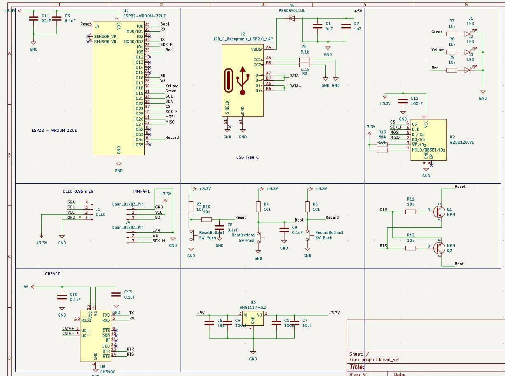
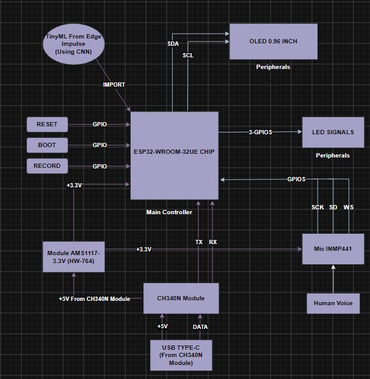
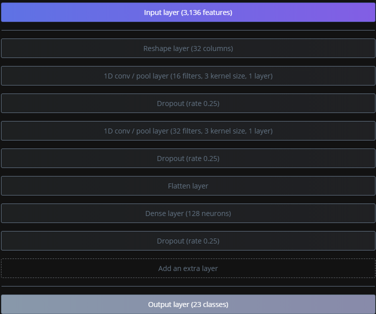
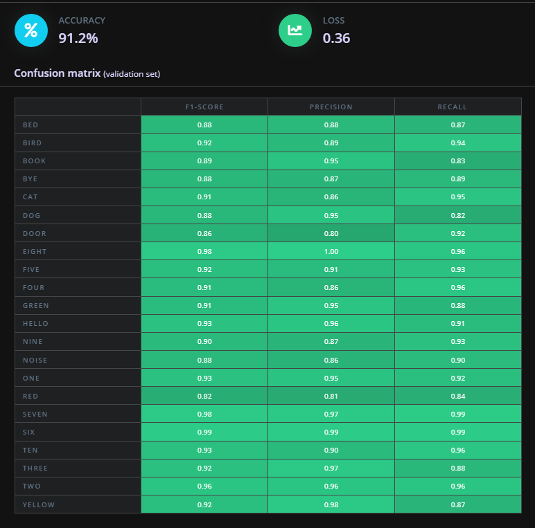

# AI Speech-to-Text: Offline Keyword Spotting on ESP32

[](hardware/README.md)
[](ml/README.md)
[](firmware/README.md)
[](LICENSE)

A self-designed ESP32-WROOM-32UE board listens through an INMP441 microphone, runs a 1D-CNN keyword spotter (22 classes) fully on the chip, and shows the word and confidence on an OLED. No cloud, no Wi-Fi at run time.

Report: [EN (PDF)](docs/report/CDP301_Final_Report.pdf)

## Project Structure

```
.
├── firmware/
│   ├── kws_inference/kws_inference.ino      # custom board: record 1 s -> MFE -> CNN -> OLED + LEDs
│   └── dataset_capture/dataset_capture.ino  # ESP32-S3 dev kit: stream 1 s WAV over serial
├── tools/capture_audio.py                   # PC push-to-talk recorder (hold SPACE)
├── ml/                                      # Edge Impulse settings; exported library: see edge-impulse-model/ and the Release
├── dataset/                                 # labels, recording protocol, statistics
├── hardware/                                # BOM, pin mapping, KiCad schematic and PCB
├── tests/                                   # WAV format checker, smoke test checklist
└── docs/                                    # report, figures, demo
```

## Firmware Flow

`kws_inference` is a single superloop, no RTOS tasks.

```
setup()
├── Serial 115200, LED pins (red = idle), OLED (I2C 0x3C)
├── allocate 16000 x int16 buffer, i2s_init(): 16 kHz, 32-bit frames, shift right 14 + clamp -> int16
└── on failure: OLED "Error!", all LEDs on, button ignored
loop()
└── Record button (IO34, active-low, 30 ms debounce)
    ├── yellow LED -> record_one_second(): drop 200 ms, collect 16000 samples, remove DC offset
    ├── run_classifier(): MFE + CNN
    ├── top class -> label + confidence -> OLED and serial (no rejection threshold)
    └── green LED (red or yellow if the label is "red" or "yellow") -> hold 1.5 s -> idle
```

## Component Index

| Component | Path | Role |
|---|---|---|
| Inference firmware | `firmware/kws_inference/` | On-device keyword spotting with OLED and LED output |
| Capture firmware | `firmware/dataset_capture/` | Sends one 1 s WAV per `R` command |
| Recorder | `tools/capture_audio.py` | Saves WAV clips per label |
| WAV checker | `tests/check_wav.py` | Verifies 16 kHz, 16-bit, mono, 1 s |
| Smoke test | `tests/smoke_test.md` | Manual pass/fail checklist for both boards |
| Model settings | `ml/README.md` | MFE, CNN, quantization, deployment |

## Hardware

Parts: ESP32-WROOM-32UE, INMP441, SSD1306 0.96" OLED, AMS1117-3.3, CH340C, W25Q256JVEIQ SPI flash, three LEDs, three buttons. Full list and the pin table are in [`hardware/README.md`](hardware/README.md).

| Signal | GPIO | Peripheral | Note |
|---|---|---|---|
| SD / WS / SCK | IO16 / IO17 / IO4 | INMP441 | I2S, L/R tied to GND (left) |
| SDA / SCL | IO22 / IO21 | SSD1306 | I2C, address 0x3C |
| Red / Yellow / Green | IO18 / IO5 / IO19 | Status LEDs | Idle / working / result |
| Record | IO34 | Button | Input-only, external pull-up |

<p align="center"></p>

## Data Flow

```
voice -> INMP441 --I2S 16 kHz--> ESP32 SRAM buffer (1 s, 16000 samples)
      -> MFE (25 ms frames, 10 ms stride, 32 Mel filters, FFT 256)  -> 3136 features
      -> 1D CNN (Conv16 -> Conv32 -> Dense128 -> 22 classes)
      -> top class + confidence -> OLED text, LED, serial log
```

<p align="center"></p>

## Model

22 classes (noise included): bed, bird, book, bye, cat, dog, door, eight, five, four, green, hello, nine, noise, one, red, seven, six, ten, three, two, yellow. Data was recorded with the INMP441 on an ESP32-S3 dev kit and extended with synthetic text-to-speech clips; training details and exported size are in [`ml/README.md`](ml/README.md).

<p align="center">
  
  
</p>

## Getting Started

### Build and Flash

```bash
arduino-cli core install esp32:esp32
arduino-cli lib install "Adafruit GFX Library" "Adafruit SSD1306"

# Download AI_Keyword_Spotting.zip from the v1.0.0 Release (or export your own from Edge Impulse:
# Arduino library, EON, int8) into ml/edge-impulse-model/. SHA-256 is in ml/edge-impulse-model/README.md
arduino-cli config set library.enable_unsafe_install true
arduino-cli lib install --zip-path ml/edge-impulse-model/AI_Keyword_Spotting.zip

arduino-cli compile --fqbn esp32:esp32:esp32 firmware/kws_inference
arduino-cli upload  --fqbn esp32:esp32:esp32 -p <PORT> firmware/kws_inference
```

### Record your own data

```bash
arduino-cli compile --fqbn esp32:esp32:esp32s3 firmware/dataset_capture
arduino-cli upload  --fqbn esp32:esp32:esp32s3 -p <PORT> firmware/dataset_capture
pip install pyserial keyboard
python tools/capture_audio.py          # edit PORT and LABEL first; hold SPACE to record
python tests/check_wav.py recordings/  # verify the clips
```

Run [`tests/smoke_test.md`](tests/smoke_test.md) after flashing.

## Results

| Metric | Value | Source |
|---|---|---|
| Validation accuracy | 91.2 % (loss 0.36), 22 classes | Edge Impulse |
| Model size, int8 + EON | 136.1 KB flash, 16.8 KB RAM | Edge Impulse estimate |
| Latency, int8 | about 372 ms (MFE 361 ms + CNN 11 ms) | Edge Impulse estimate, not measured on the board |
| Demo capture | `book`, 56.6 % on the OLED | Photo in the report |

Not yet measured: on-device latency, accuracy on the physical board. Hardware files have known mismatches (LED labels, schematic vs PCB); see [`hardware/README.md`](hardware/README.md#known-discrepancies).

## Roadmap

- [ ] Measure on-device latency and accuracy with the real board
- [ ] Record the Arduino core and library versions used for the build
- [ ] Add a rejection threshold (currently the top class is always shown)
- [ ] Add a Vietnamese version of the report
- [ ] Add the demo video and the Gerber files
- [ ] Bring the KiCad schematic in line with the fabricated PCB (see hardware/README.md)

## Author

Phạm Minh Tùng, Trần Tuấn Lâm, Vũ Minh Quân, Đỗ Phước Hùng, Nguyễn Nam Khánh. CDP301, FPT University, May 2026.

## License

[MIT](LICENSE)
